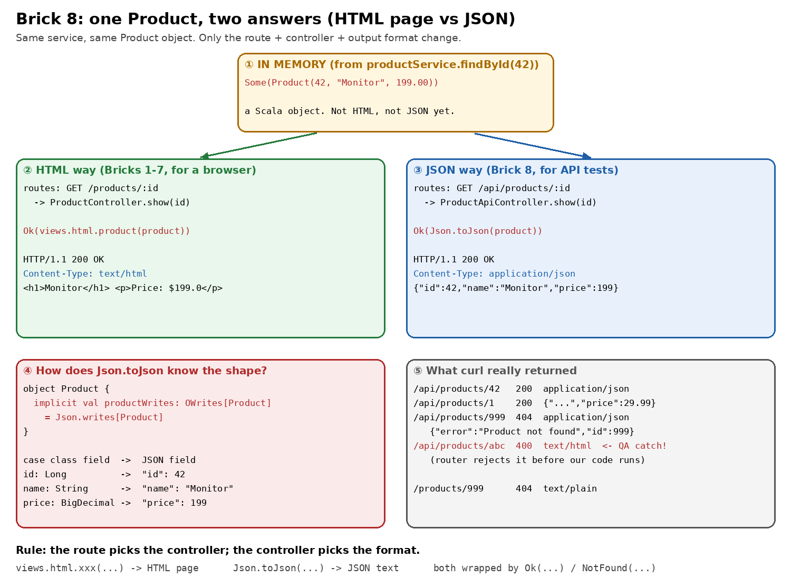
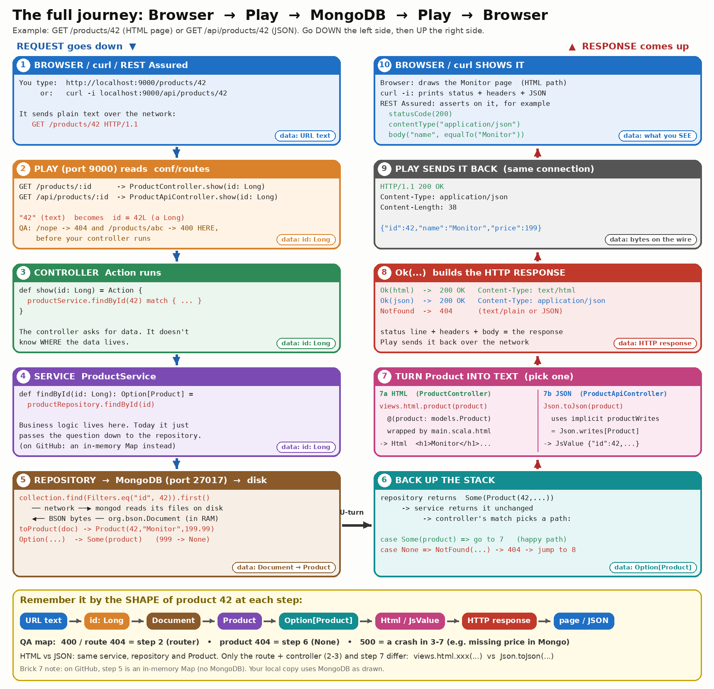

# Brick 8: a JSON endpoint (`GET /api/products/:id`)



**The whole journey in one picture** (Browser → Play → MongoDB → Play → Browser):



Up to Brick 7, the app answered with **HTML pages** for a person using a browser.
API tests (curl, Postman, REST Assured) want **JSON**: plain data with no page
around it. In this brick you add a second URL that returns the **same product**
as JSON.

```
GET /products/42      ->  <h1>Monitor</h1> ...                  (HTML, for people)
GET /api/products/42  ->  {"id":42,"name":"Monitor","price":199} (JSON, for tests/apps)
```

There are 4 steps, and each one ends with a check.

---

## Step 1: add the route

`conf/routes`, under the `/products/:id` line:

```
# The same product, as JSON (for API tests). Same :id idea, different controller.
GET     /api/products/:id     controllers.ProductApiController.show(id: Long)
```

The URL pattern works like Brick 1, with `:id` → `Long`. The only new thing is
that it points to a **new controller**, `ProductApiController`. Keeping the
HTML and JSON controllers apart means each one has one job.

> **Check 1:** If you save `conf/routes` now, before Step 3, and refresh the
> browser, what error do you expect? (Hint: the routes file points to a class
> that doesn't exist yet.)

---

## Step 2: teach Play how to turn a `Product` into JSON

`app/models/Product.scala`:

```scala
package models

import play.api.libs.json.{Json, OWrites}

case class Product(id: Long, name: String, price: BigDecimal)

object Product {
  implicit val productWrites: OWrites[Product] = Json.writes[Product]
}
```

Read it slowly:

- `object Product` is the case class's **companion object**: the same name,
  in the same file. Scala looks here automatically when it needs extra
  "knowledge" about `Product`.
- `OWrites[Product]` is a **recipe** for writing a Product as a JSON object.
- `Json.writes[Product]` builds that recipe at compile time from the fields:
  `id` → `"id"`, `name` → `"name"`, `price` → `"price"`.
- `implicit` means "use this automatically whenever someone needs a
  `Writes[Product]`". So in Step 3 you never pass it by hand.

> **Check 2:** If you added a field `stock: Int` to `Product` (and to the 3
> products in `ProductService`), what would the JSON for product 42 look like?

---

## Step 3: the controller

New file `app/controllers/ProductApiController.scala`:

```scala
package controllers

import javax.inject.Inject
import play.api.libs.json.Json
import play.api.mvc._
import services.ProductService

class ProductApiController @Inject() (
    productService: ProductService,
    cc: ControllerComponents
) extends AbstractController(cc) {

  def show(id: Long): Action[AnyContent] = Action {
    productService.findById(id) match {
      case Some(product) =>
        Ok(Json.toJson(product))                                   // 200 + application/json

      case None =>
        NotFound(Json.obj("error" -> "Product not found", "id" -> id)) // 404, still JSON
    }
  }
}
```

Put it next to `ProductController` and compare them. It's the **same shape**,
and only one line differs:

| | `ProductController` (HTML) | `ProductApiController` (JSON) |
|---|---|---|
| found | `Ok(views.html.product(product))` | `Ok(Json.toJson(product))` |
| not found | `NotFound("Sorry, ...")` (plain text) | `NotFound(Json.obj(...))` (JSON) |
| Content-Type | `text/html` | `application/json` |

- `Json.toJson(product)` finds the `implicit` recipe from Step 2 and returns a
  `JsValue`, which is JSON held in memory.
- When `Ok(...)` gets a `JsValue`, Play sets `Content-Type: application/json`
  for you. That's the same idea as `Ok(html)` setting `text/html`.
- `Json.obj("error" -> ..., "id" -> id)` builds a JSON object by hand. This is
  good for small error bodies. A good API returns JSON for errors too, so the
  client can always parse the answer.
- If you used `Json.toJson(product)` **without** Step 2, you'd get a compile
  error: `No Json serializer found for type models.Product`.

> **Check 3:** Which `ProductService` method does this controller use, and is
> it the same one the HTML controller uses? What does that tell you about
> where the data comes from (the `Map` here, or MongoDB in your local copy)?

---

## Step 4: test it like a QA engineer

Run `sbt run`, then in another WSL terminal:

```bash
curl -i localhost:9000/api/products/42
curl -i localhost:9000/api/products/999
curl -i localhost:9000/api/products/abc
```

Real output from this repo (headers trimmed):

```
GET /api/products/42
HTTP/1.1 200 OK
Content-Type: application/json
{"id":42,"name":"Monitor","price":199}

GET /api/products/1
HTTP/1.1 200 OK
{"id":1,"name":"Keyboard","price":29.99}

GET /api/products/999
HTTP/1.1 404 Not Found
Content-Type: application/json
{"error":"Product not found","id":999}

GET /api/products/abc
HTTP/1.1 400 Bad Request
Content-Type: text/html; charset=UTF-8
<!DOCTYPE html> ... <title>Bad Request</title> ...
```

Three QA catches in that output:

1. **`"price":199`**: the service has `BigDecimal(199.00)`, and JSON prints it
   as `199`. The HTML page printed `$199.0`. Same value, three spellings. An
   API test that compares the *text* `"199.00"` fails, so compare the *number*
   instead.
2. **`/abc` returns HTML, not JSON.** The router rejects `abc` (it isn't a
   `Long`) **before** `ProductApiController` runs, so our JSON `NotFound`
   never gets the chance. Play's default error page answers instead, and it
   did so even when I sent `Accept: application/json`. That's a real
   "inconsistent error format" bug you could report on an API.
3. **The two 404s look different.** `/api/products/999` returns JSON, but
   `/products/999` returns `text/plain`. That's fine here, because the second
   one is for browsers. Still, always assert on **status + Content-Type +
   body**, not just the status.

> **Check 4:** Write down the 3 things a REST Assured test for
> `GET /api/products/999` should assert (status, header, body).

---

## Answers

<details><summary>Show answers</summary>

- **1:** A compile error, pointing at `conf/routes` line 17:
  `type ProductApiController is not a member of package controllers` /
  `did you mean ProductController?`. The routes file is compiled into Scala, so a wrong
  class name is caught at compile time.
- **2:** `{"id":42,"name":"Monitor","price":199,"stock":5}` (with whatever
  stock value you gave it). `Json.writes` picks up the new field by itself.
- **3:** `productService.findById(id)`, the same method. Both controllers get
  their data from the same service, so in your local copy the JSON endpoint
  reads from MongoDB with no extra work. Only the output format differs.
- **4:** status `404`; header `Content-Type` contains `application/json`;
  body `error == "Product not found"` and `id == 999`.

</details>
