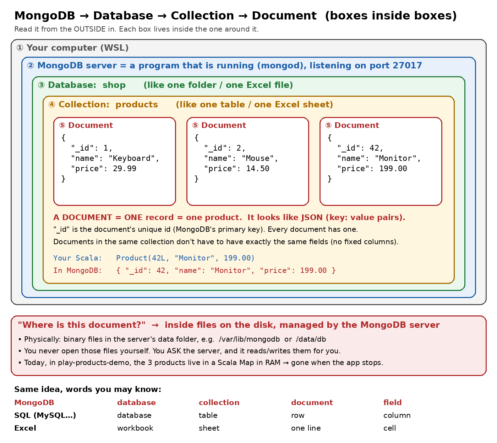
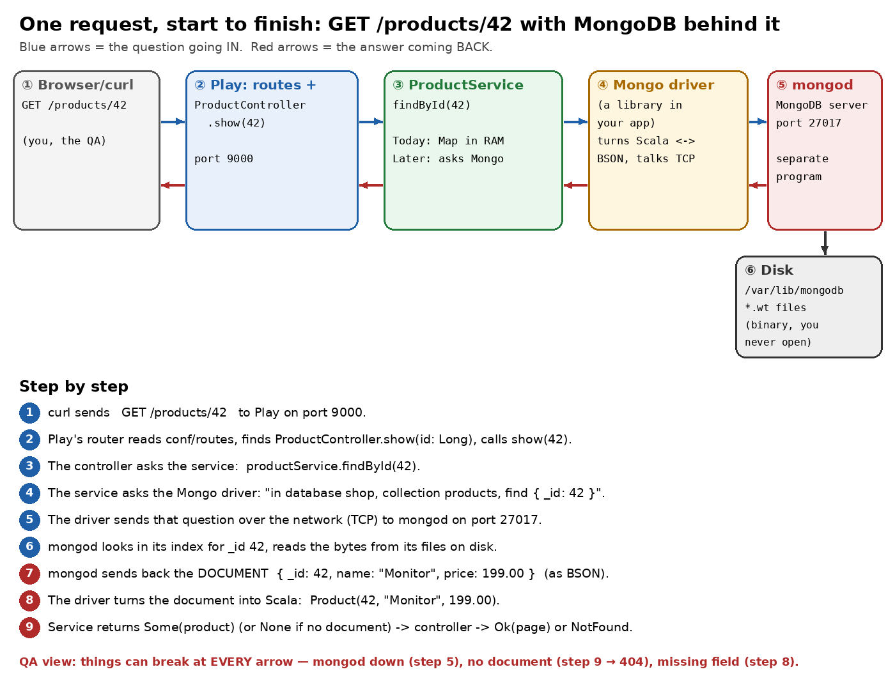

# MongoDB and "Documents", from zero

This guide is for someone new to databases. It uses the same 3 products that
`app/services/ProductService.scala` holds today (Keyboard, Mouse, Monitor), so
nothing here is new data. Only the place it lives changes.

Read it in order. Each part ends with a **check**. Answer it before you move on.

---

## Part 0: why we need a database at all

Open `app/services/ProductService.scala`:

```scala
private val products: Map[Long, Product] = Map(
  1L  -> Product(1L,  "Keyboard",  29.99),
  2L  -> Product(2L,  "Mouse",     14.50),
  42L -> Product(42L, "Monitor",  199.00)
)
```

That `Map` lives in **RAM** (memory), inside your running Play app.

- Stop `sbt run`, and the Map is gone. Start it again, and the code rebuilds it
  from scratch.
- Code can't add a product that survives a restart. Any change is lost.
- If you run 2 copies of the app, each copy has its **own** Map, so they
  can disagree.

A **database** solves this. It is a separate program whose only job is to keep
data **on disk** (it survives restarts) and hand it to anyone who asks.

> **Check 0:** Where are the 3 products stored today? What happens to them when
> you press Ctrl+C on `sbt run`?

---

## Part 1: what MongoDB is

**MongoDB is a database server**, a program that runs and waits for questions,
just like Play does.

| | Play app | MongoDB |
|---|---|---|
| Program name | `sbt run` (Pekko HTTP inside) | `mongod` (the "d" = daemon = background program) |
| Port | 9000 | **27017** |
| Who talks to it | browser / `curl` | your app (through a **driver**), or the `mongosh` shell |
| What it gives back | HTML / JSON pages | **documents** |

So when your app "uses MongoDB", it means two programs talk over the network:
**Play (port 9000) asks mongod (port 27017)**. This is the same idea as
`order-service` asking `user-service` in the microservices repo.

> **Check 1:** Name the two programs that run when a Play app uses MongoDB, and
> the port of each.

---

## Part 2: the 4 boxes (MongoDB → Database → Collection → Document)



Read the sketch from the **outside in**:

1. **MongoDB server** (`mongod`): the running program. One server can hold many
   databases.
2. **Database** (e.g. `shop`): a named group of related data. Think of one
   Excel *file*.
3. **Collection** (e.g. `products`): a named list of records of the same kind.
   Think of one *sheet* in that Excel file, or a **table** in SQL.
4. **Document**: **ONE record** in that list, i.e. **one product**. Think of one
   line in the sheet, or a **row** in SQL.

Inside a document are **fields** (`name`, `price`, ...), like columns or cells.

| MongoDB | database | collection | document | field |
|---|---|---|---|---|
| SQL (MySQL, Postgres) | database | table | row | column |
| Excel | workbook | sheet | one line | cell |

> **Check 2:** In this guide, what is the name of the database? The
> collection? How many documents are in the collection?

---

## Part 3: what a document looks like

A document is written like **JSON**: `"key": value` pairs inside `{ }`.

Your Scala product 42 and its MongoDB document hold the **same data in a
different shape**:

```
Scala (in your app):   Product(42L, "Monitor", 199.00)
MongoDB document:      { "_id": 42, "name": "Monitor", "price": 199.00 }
```

Field by field:

| Scala case class field | Document field | Note |
|---|---|---|
| `id: Long` | `_id` | **special**: see below |
| `name: String` | `name` | a string |
| `price: BigDecimal` | `price` | a number |

### The `_id` field

- **Every** document must have an `_id`. If you don't give one, MongoDB makes
  one for you (an `ObjectId` like `6543a1f0c2...`).
- `_id` is **unique inside a collection**. Inserting a second document with
  `_id: 42` is an **error** (duplicate key). It does not overwrite the first one.
- Finding by `_id` is the fastest lookup, because MongoDB keeps an index on it.

### Documents don't need the same fields

An SQL table forces every row to have the same columns. A MongoDB collection
**does not**:

```
{ "_id": 1,  "name": "Keyboard", "price": 29.99 }
{ "_id": 2,  "name": "Mouse",    "price": 14.50, "colour": "black" }
{ "_id": 42, "name": "Monitor" }                       <- no price!
```

All three are allowed. **QA angle:** that freedom is a source of bugs. If your
Scala code expects `price` and a document has none, turning it into a
`Product` fails (Part 5, step 8). "Document is missing a field" is a real
test case.

> **Check 3:** Write the document for product **2** (Mouse) by hand.

---

## Part 4: "where IS this document?"

There are two answers, and both are true.

### 4a. Logically: an address

You find a document by its **address**:

```
server (localhost:27017)  →  database "shop"  →  collection "products"  →  document with _id 42
```

In the MongoDB shell, that address is one line:

```js
use("shop")                       // pick the database
db.products.find({ _id: 42 })     // in collection "products", find the document with _id 42
```

### 4b. Physically: files on disk that you never open

`mongod` stores everything as **binary files** in its data folder (usually
`/var/lib/mongodb` on Linux, or `/data/db` in Docker). I ran a real MongoDB 7 on
my machine, and its data folder looked like this:

```
collection-2--1459880828139976215.wt     <- the documents of a collection
index-3--1459880828139976215.wt          <- the _id index for it
WiredTiger.wt, journal/, mongod.lock, ...
```

There's **no** file called `products.json` and **no** one-file-per-document.
The files are in a binary format (WiredTiger, `.wt`). You never open or edit
them. You **ask the server** and it reads them for you. This is the same as
using `curl` to ask Play, instead of looking inside Play's memory.

> **Check 4:** Finish the sentence: "Product 42 lives in database ____,
> collection ____, and I find it by the field ____. Physically, it's inside
> ____ files that only ____ reads."

---

## Part 5: one request from start to finish



`GET /products/42` once `ProductService` asks MongoDB instead of the Map:

1. `curl` sends `GET /products/42` to Play on port **9000**.
2. Play's router reads `conf/routes`, matches `ProductController.show(id: Long)`,
   and calls `show(42)`.
3. The controller calls `productService.findById(42)`.
4. The service asks the **MongoDB driver**: "in database `shop`, collection
   `products`, find `{ _id: 42 }`". (A *driver* is a library added to
   `build.sbt`. It is the code that knows how to talk to `mongod`.)
5. The driver sends that question over the network to `mongod` on port **27017**.
6. `mongod` uses its `_id` index and reads the bytes from its `.wt` files.
7. `mongod` sends the **document** back (in **BSON**, which is "binary JSON",
   the format MongoDB uses on the wire and on disk).
8. The driver turns the document into Scala: `Product(42, "Monitor", 199.00)`.
9. The service returns `Some(product)`. If no document matched, it returns
   `None`. The controller turns that into `Ok(page)` (200) or `NotFound` (404).

**Things that stay the same:** steps 1–3 and 9, meaning the routes, the
controller, and the 200/404 logic. **Things that change:** only *inside*
`ProductService`. That's why the service layer exists.

### Where a QA engineer looks for bugs (one per arrow)

| Step | What breaks | What the user sees |
|---|---|---|
| 5 | `mongod` is down / wrong port | slow request, then 500 (unless the code handles it) |
| 6 | no document with that `_id` | `find` returns **empty**, not an error, so it must become 404 |
| 8 | document is missing a field / wrong type | error when turning it into `Product`, so 500 |
| 8 | number formatting | `199.00` comes back as `199` (see Part 6) |

> **Check 5:** For `GET /products/999`, which step decides it's a 404, and what
> does `mongod` actually send back?

---

## Part 6 (optional): see a real document yourself

You only need this if you want to *see* it. Docker gives you a throwaway
MongoDB in WSL:

```bash
docker run -d --name mongo-try -p 27017:27017 mongo:7
docker exec -it mongo-try mongosh
```

Then, inside `mongosh`, type these one at a time:

```js
use("shop")
db.products.insertMany([
  { _id: 1,  name: "Keyboard", price: 29.99 },
  { _id: 2,  name: "Mouse",    price: 14.50 },
  { _id: 42, name: "Monitor",  price: 199.00 }
])
db.products.find({ _id: 42 })      // the document
db.products.find({ _id: 999 })     // nothing at all, not an error
db.getCollectionNames()            // [ 'products' ]
```

What I saw when I ran exactly this:

```
[ { _id: 42, name: 'Monitor', price: 199 } ]      <- 199.00 became 199
[]                                                <- 999: empty, no error
[ 'products' ]
```

Two QA lessons from real output:
- `199.00` came back as `199`, and `14.50` would come back as `14.5`. A plain
  number has no "two decimals". If a page must show `£199.00`, the code has
  to format it. Same family of bug as `Price: $199.0` in this demo.
- A missing document isn't an error. It's an **empty result**. Your code must
  turn "empty" into 404 on purpose.

Clean up afterwards: `exit`, then `docker rm -f mongo-try`.

---

## Answers (cover these until you've tried)

<details><summary>Show answers</summary>

- **0:** In a Scala `Map` in RAM, inside the Play app. Stopping `sbt run`
  loses them, and the code recreates the same 3 on the next start.
- **1:** Play (port 9000) and `mongod` (port 27017).
- **2:** Database `shop`, collection `products`, 3 documents.
- **3:** `{ "_id": 2, "name": "Mouse", "price": 14.50 }`
- **4:** `shop`, `products`, `_id`, binary `.wt`, `mongod`.
- **5:** `mongod` sends back an empty result (no documents). The service
  turns that into `None` (step 9), and the controller turns `None` into
  `NotFound` (404).

</details>
