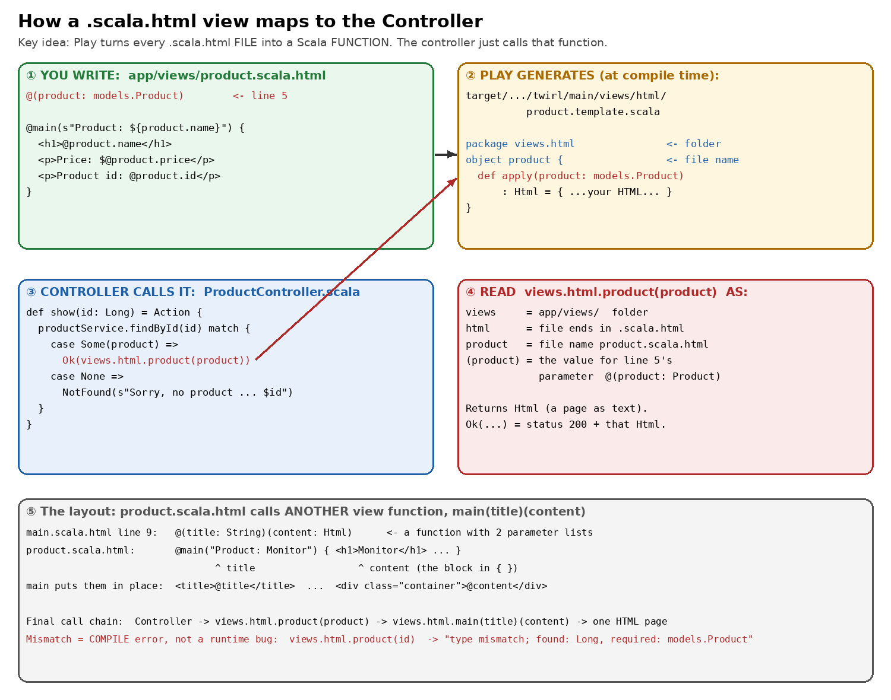

# How a `.scala.html` view maps to the Controller



**The one idea:** Play turns every `.scala.html` **file** into a Scala
**function** when it compiles. The controller just **calls that function** and
passes it the data. There is no hidden magic and no matching by strings.

---

## Step 1: the first line of the view is a parameter list

`app/views/product.scala.html`, line 5:

```
@(product: models.Product)
```

Read it like a function signature: "this page needs **one** value, named
`product`, of type `models.Product`." Everything below that line can use
`product`.

`@` means "Scala starts here". `@product.name` = "insert the value of
`product.name` into the HTML at this spot".

> **Check 1:** How many parameters does `index.scala.html` take, and of which
> type? (Look at its line 5.)

---

## Step 2: Play generates a real Scala file from it

When you run `sbt compile` (or the first request in `sbt run`), Play's template
engine (**Twirl**) writes this file. It's real output from this repo:

`target/scala-2.13/twirl/main/views/html/product.template.scala`

```scala
package views.html                                  // <- from the folder app/views + ".html" ending

object product ... {                                // <- from the file name product.scala.html
  def apply(product: models.Product): HtmlFormat.Appendable = {   // <- from line 5
    ... "<h1>" ... product.name ... "</h1>" ...      // <- your HTML, with @ values plugged in
  }
}
```

So the name is built like this:

| Piece of `views.html.product` | Comes from |
|---|---|
| `views` | the folder `app/views/` |
| `html` | the file ends in `.scala.html` (a `.scala.txt` file would give `views.txt`) |
| `product` | the file name `product.scala.html` |
| `(product: models.Product)` | line 5 of the file |

> **Check 2:** Run `sbt compile`, then open
> `target/scala-2.13/twirl/main/views/html/product.template.scala`. Find the
> `def apply(...)` line. Which line of your `.scala.html` did its parameter come
> from?

---

## Step 3: the controller calls the function

`app/controllers/ProductController.scala`:

```scala
case Some(product) =>
  Ok(views.html.product(product))
```

Read it inside-out:

1. `views.html.product(product)` calls the generated `apply` and passes the
   `Product` the service found. It returns `Html`, which is the page as text.
2. `Ok(...)` wraps that text in an HTTP response: status **200** +
   `Content-Type: text/html`.

`HomeController` does exactly the same with the other view:

```scala
Ok(views.html.index(productService.findAll()))   // index.scala.html: @(products: Seq[models.Product])
```

**The mapping is the function call.** File name = function name, and the
first line = the parameters the controller must pass.

---

## Step 4: the layout, a view calling another view

`main.scala.html`, line 9:

```
@(title: String)(content: Html)
```

That's a function with **two** parameter lists. `product.scala.html` calls it:

```
@main(s"Product: ${product.name}") {      <- title = "Product: Monitor"
    <h1>@product.name</h1> ...            <- content = everything inside { }
}
```

`main` puts `title` into `<title>@title</title>` and `content` into
`<div class="container">@content</div>`.

Full chain:

```
ProductController.show(42)
  → views.html.product(product)            (product.scala.html)
      → views.html.main(title)(content)    (main.scala.html)
  → one HTML page → Ok(...) → 200 → browser
```

What `curl -i localhost:9000/products/42` actually returned when I ran it
(trimmed):

```
HTTP/1.1 200 OK
Content-Type: text/html; charset=UTF-8

<!DOCTYPE html>
<html lang="en">
    <head>
        <title>Product: Monitor</title>                     <- from main's @title
        ...
        <div class="container">                             <- main's @content starts
    <p><a href="/">&larr; Back to all products</a></p>     <- @routes.HomeController.index() became "/"
    <h1>Monitor</h1>                                        <- @product.name
    <p class="price">Price: $199.0</p>                      <- @product.price (QA catch: "199.0")
    <p class="id">Product id: 42</p>                        <- @product.id
        </div>
```

Bonus: `@routes.HomeController.index()` became `/` in the output. The view
asks the **routes file** for the URL, so if you change the URL in
`conf/routes`, every link updates by itself.

---

## Step 5: why this matters for QA (mismatches are compile errors)

Because the view is a typed function, a wrong call **doesn't compile**. I
changed the controller to pass the `id` (a `Long`) instead of the `Product`:

```scala
Ok(views.html.product(id))
```

and `sbt compile` said:

```
[error] ProductController.scala:22:31: type mismatch;
[error]  found   : Long
[error]  required: models.Product
[error]         Ok(views.html.product(id))
```

So "the controller passed the wrong data to the page" is caught **before** the
app runs. The bugs that are left for you to find are about **values**, not
wiring: the `$199.0` price formatting, a missing product (404), or text that
isn't escaped. (Twirl escapes `@product.name` by default, so a product named
`<script>` would show up as text, not run.)

> **Check 5:** Try the same break yourself. Change line 22 to
> `Ok(views.html.product(id))`, refresh `/products/42` in the browser while
> `sbt run` is running, read the error page, then undo the change.

---

## Answers

<details><summary>Show answers</summary>

- **1:** One parameter, `products: Seq[models.Product]` (a list of products).
- **2:** Line 5, `@(product: models.Product)`.
- **5:** You should see Play's compile-error page with the same
  `type mismatch; found: Long, required: models.Product` message, pointing at
  line 22.

</details>
